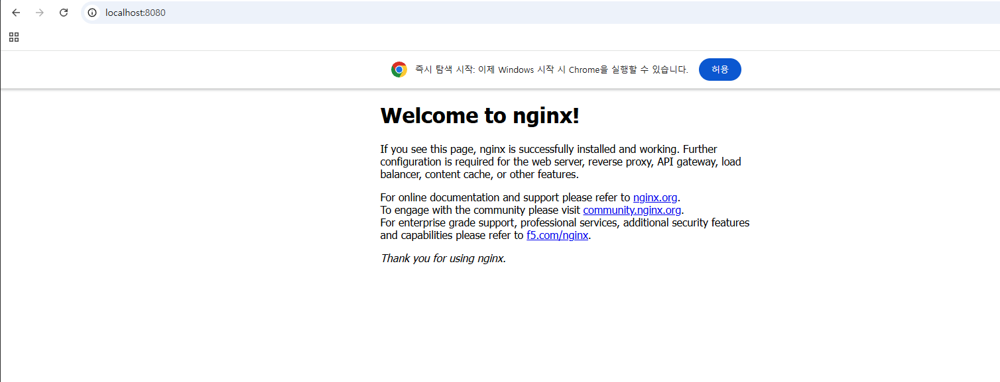
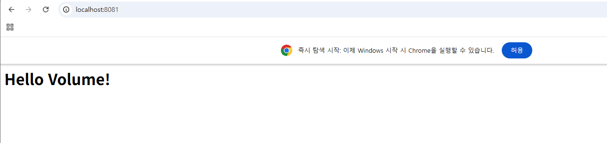
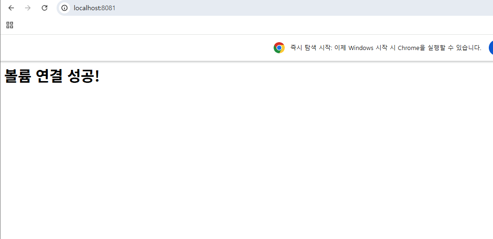
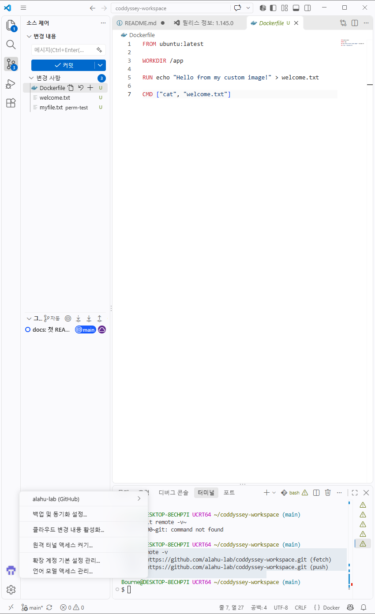

# 코디세이 개발 워크스테이션 구축

터미널, Docker, Git/GitHub를 직접 세팅하고 실행 결과(로그, 접속, 데이터 유지)로 검증한 기록입니다.

## 1) 프로젝트 개요

- 목표: "내 컴퓨터에서만 돌아가는" 문제를 줄이기 위해 리눅스 CLI, Docker, Git/GitHub로 재현 가능한 개발 환경을 구축한다.
- 범위: 터미널 조작, 파일 권한, Docker 설치/운영, Dockerfile 커스텀 이미지, 포트 매핑, 바인드 마운트, Docker 볼륨 영속성, Git/GitHub 연동

## 2) 실행 환경

- OS: Windows 11 (10.0.26200)
- Shell: Git Bash (MSYS2 UCRT64), 일부 PowerShell
- Docker: Docker Desktop 4.98.0 (WSL 2 backend)
- 편집기: VS Code

```bash
$ docker --version
Docker version 29.9.2, build a82e528

$ git --version
git version 2.56.0.windows.4
```

## 3) 수행 체크리스트

- [x] 터미널 기본 조작 및 폴더 구성 → [4)](#4-터미널-조작-로그)
- [x] 권한 변경 실습 → [5)](#5-권한-실습-전후-비교)
- [x] Docker 설치/점검 → [6)](#6-docker-설치-및-점검)
- [x] Docker 기본 운영 명령 → [7)](#7-docker-기본-운영-명령)
- [x] hello-world 실행, ubuntu 컨테이너 진입, exec 관찰 → [8)](#8-컨테이너-실행-실습)
- [x] Dockerfile 빌드/실행 → [9)](#9-dockerfile-커스텀-이미지)
- [x] 포트 매핑 접속 (8080, 8081) → [10)](#10-포트-매핑-접속-증거)
- [x] 바인드 마운트 반영 → [11)](#11-바인드-마운트-반영)
- [x] Docker 볼륨 영속성 → [12)](#12-docker-볼륨-영속성-검증)
- [x] Git 설정 + VS Code GitHub 연동 → [13)](#13-git--github-연동)
- [x] 트러블슈팅 → [14)](#14-트러블슈팅)

## 4) 터미널 조작 로그

```bash
$ pwd
/c/Users/Bourne/coddyssey-workspace

$ ls -l
total 0
-rw-r--r-- 1 Bourne 197121 0 11월  5 19:36 README.md

$ mkdir practice
$ cd practice
$ touch hello.txt
$ echo "안녕하세요 Git Bash!" > hello.txt
$ cat hello.txt
안녕하세요 Git Bash!

$ cp hello.txt copy.txt
$ mv copy.txt renamed.txt
$ ls -l
total 2
-rw-r--r-- 1 Bourne 197121 26 11월  5 19:42 hello.txt
-rw-r--r-- 1 Bourne 197121 26 11월  5 19:53 renamed.txt

$ rm renamed.txt
$ ls -l
total 1
-rw-r--r-- 1 Bourne 197121 26 11월  5 19:42 hello.txt

$ cd ..
$ rm -r practice
```

숨김 파일 포함 목록 (`.git/`이 보인다):

```bash
$ ls -la
total 25
drwxr-xr-x 1 Bourne 197121   0 11월  5 20:23 ./
drwxr-xr-x 1 Bourne 197121   0 11월  5 20:38 ../
drwxr-xr-x 1 Bourne 197121   0 11월  5 20:13 .git/
-rw-r--r-- 1 Bourne 197121 120 11월  5 20:23 Dockerfile
drwxr-xr-x 1 Bourne 197121   0 11월  5 20:16 perm-test/
-rw-r--r-- 1 Bourne 197121   0 11월  5 19:36 README.md
```

절대 경로와 상대 경로: `/c/Users/Bourne/coddyssey-workspace`는 루트(`/`)부터 시작하는 절대 경로이고, `cd ..`나 `cd practice`처럼 현재 위치 기준으로 쓰는 것이 상대 경로이다. 절대 경로는 어디서 실행해도 같은 곳을 가리키고, 상대 경로는 현재 위치에 따라 달라진다.

## 5) 권한 실습 (전/후 비교)

### 5-1) Git Bash (Windows NTFS): 변경되지 않음

```bash
$ ls -l
drwxr-xr-x 1 Bourne 197121 0 11월  5 20:38 mydir/
-rw-r--r-- 1 Bourne 197121 0 11월  5 20:38 test.sh

$ chmod 700 test.sh
$ chmod 777 mydir
$ ls -l
drwxr-xr-x 1 Bourne 197121 0 11월  5 20:38 mydir/
-rw-r--r-- 1 Bourne 197121 0 11월  5 20:38 test.sh
```

Windows 파일시스템은 리눅스식 권한 비트를 저장하지 않아 `chmod`가 반영되지 않았다.

### 5-2) ubuntu 컨테이너 (리눅스): 정상 변경

```bash
$ docker run -it ubuntu bash
root@0586630133c5:/# cd /tmp
root@0586630133c5:/tmp# touch test.sh
root@0586630133c5:/tmp# mkdir mydir
root@0586630133c5:/tmp# ls -l
total 4
drwxr-xr-x 2 root root 4096 Nov  5 11:40 mydir
-rw-r--r-- 1 root root    0 Nov  5 11:40 test.sh

root@0586630133c5:/tmp# chmod 700 test.sh
root@0586630133c5:/tmp# chmod 777 mydir
root@0586630133c5:/tmp# ls -l
total 4
drwxrwxrwx 2 root root 4096 Nov  5 11:40 mydir
-rwx------ 1 root root    0 Nov  5 11:40 test.sh
```

| 대상 | 변경 전 | 변경 후 |
|---|---|---|
| test.sh (파일) | `-rw-r--r--` (644) | `-rwx------` (700) |
| mydir (디렉토리) | `drwxr-xr-x` (755) | `drwxrwxrwx` (777) |

해석 규칙: 맨 앞 글자는 종류(`-` 파일, `d` 디렉토리)이고, 나머지 9글자를 소유자/그룹/기타 3개씩 끊어 읽는다. r=4, w=2, x=1이며 자리별로 더한 값이 숫자 표기다. 644는 소유자 rw, 그룹/기타 r이고, 755는 소유자 rwx, 그룹/기타 rx이다. 700은 소유자만 전부 가능하고, 777은 모두 전부 가능하다.

## 6) Docker 설치 및 점검

```bash
$ docker --version
Docker version 29.9.2, build a82e528

$ docker info        # 발췌
Client:
 Version:    29.9.2
 Context:    desktop-linux
Server:
 Containers: 6
  Running: 1
  Stopped: 5
 Images: 4
 Server Version: 29.9.2
 Storage Driver: overlayfs
 Kernel Version: 6.18.54.1-microsoft-standard-WSL2
 Operating System: Docker Desktop
 OSType: linux
 Architecture: x86_64
```

`Server` 항목이 출력되므로 Docker 데몬이 정상 동작 중이다.

## 7) Docker 기본 운영 명령

```bash
$ docker images
IMAGE                   ID             DISK USAGE   CONTENT SIZE
hello-world:latest      c567b231f656       25.9kB         9.49kB
my-first-image:latest   bea3ac4d0797        159MB         42.1MB
nginx:latest            165ddde8751e        243MB         66.8MB
ubuntu:latest           6a06111c3b0a        163MB         45.9MB
```

```bash
$ docker ps -a       # 발췌 (Up 과 Exited 가 함께 보인다)
CONTAINER ID   IMAGE            COMMAND             STATUS                  PORTS                      NAMES
b1b97f7ec93b   nginx            "/docker-entrypoint.…"   Up 9 minutes        0.0.0.0:8080->80/tcp       web-8080
ada54dcd583f   ubuntu           "sleep infinity"    Up 10 minutes                                      exec-test
0586630133c5   ubuntu           "bash"              Exited (127) 12 minutes ago                        awesome_chebyshev
26e272722969   nginx            "/docker-entrypoint.…"   Up 33 minutes       0.0.0.0:8081->80/tcp       elated_cray
16e3fada4a81   nginx            "/docker-entrypoint.…"   Exited (137) 39 minutes ago                    loving_clarke
8bfbe265eedb   my-first-image   "cat welcome.txt"   Exited (0) 41 minutes ago                          upbeat_carson
9c3781d94c9d   ubuntu           "bash"              Exited (0) 48 minutes ago                          perm-lab
```

`docker ps`는 실행 중인 컨테이너만, `docker ps -a`는 종료된 컨테이너까지 보여준다.

```bash
$ docker logs elated_cray        # 발췌: nginx 기동 및 접속 로그
/docker-entrypoint.sh: Configuration complete; ready for start up
2026/11/05 11:34:27 [notice] 1#1: nginx/1.31.8
172.17.0.1 - - [05/Nov/2026:11:34:34 +0000] "GET / HTTP/1.1" 200 23 ...
172.17.0.1 - - [05/Nov/2026:11:35:12 +0000] "GET / HTTP/1.1" 200 36 ...
172.17.0.1 - - [05/Nov/2026:11:35:38 +0000] "GET / HTTP/1.1" 200 58 ...
172.17.0.1 - - [05/Nov/2026:12:01:48 +0000] "GET / HTTP/1.1" 200 53 ...
```

응답 크기(`200` 뒤 숫자)가 23, 36, 58, 53바이트로 바뀐 것은 컨테이너를 재시작하지 않고 호스트 파일만 수정했는데 응답 내용이 달라졌다는 로그 증거이다. ([11)](#11-바인드-마운트-반영) 참고)

```bash
$ docker stats --no-stream
CONTAINER ID   NAME          CPU %     MEM USAGE / LIMIT     MEM %     NET I/O           BLOCK I/O     PIDS
b1b97f7ec93b   web-8080      0.00%     15.48MiB / 15.18GiB   0.10%     7.29kB / 5.57kB   0B / 12.3kB   17
ada54dcd583f   exec-test     0.00%     3.23MiB / 15.18GiB    0.02%     1.11kB / 126B     0B / 4.1kB    1
26e272722969   elated_cray   0.00%     15.32MiB / 15.18GiB   0.10%     15kB / 10.2kB     0B / 12.3kB   17
```

## 8) 컨테이너 실행 실습

### hello-world

```bash
$ docker run hello-world
Unable to find image 'hello-world:latest' locally
latest: Pulling from library/hello-world
Status: Downloaded newer image for hello-world:latest

Hello from Docker!
This message shows that your installation appears to be working correctly.
```

### ubuntu 컨테이너 내부 진입

```bash
$ docker run -it --name perm-lab ubuntu bash
root@9c3781d94c9d:/# ls
root@9c3781d94c9d:/# echo "hello ubuntu"
hello ubuntu
```

### exec 관찰: 종료해도 컨테이너가 유지된다

```bash
$ docker run -d --name exec-test ubuntu sleep infinity
$ docker exec -it exec-test bash
root@ada54dcd583f:/# exit

$ docker ps
CONTAINER ID   IMAGE    COMMAND            CREATED          STATUS          NAMES
ada54dcd583f   ubuntu   "sleep infinity"   22 seconds ago   Up 21 seconds   exec-test
```

`exit`로 쉘을 종료했는데도 `exec-test`가 `Up` 상태로 남아 있다.

### exec와 attach 차이 정리

| 구분 | `docker run -it ... bash` | `docker exec -it` | `docker attach` |
|---|---|---|---|
| 동작 | 새 컨테이너를 만들고 bash가 메인 프로세스 | 실행 중인 컨테이너에 새 프로세스를 추가 | 메인 프로세스의 입출력에 연결 |
| `exit` 후 | 컨테이너도 종료됨 (`Exited`) | 컨테이너는 계속 실행됨 | 메인 프로세스가 끝나면 컨테이너도 종료될 수 있음 |

관찰 결과: `perm-lab`(run으로 bash 실행)은 `exit` 후 `Exited (0)`이 되었고, `exec-test`(exec로 진입)는 `exit` 후에도 `Up`이었다. 이는 컨테이너 수명이 메인 프로세스(PID 1)에 달려 있기 때문이다.

## 9) Dockerfile 커스텀 이미지

- 선택한 방식: (B) Linux 베이스 이미지 + 기능 추가
- 베이스 이미지: `ubuntu:latest`

```dockerfile
FROM ubuntu:latest
WORKDIR /app
RUN echo "Hello from my custom image!" > welcome.txt
CMD ["cat", "welcome.txt"]
```

| 커스텀 포인트 | 목적 |
|---|---|
| `WORKDIR /app` | 작업 디렉토리를 고정해 경로를 일관되게 유지 |
| `RUN echo ... > welcome.txt` | 빌드 시점에 이미지 안에 파일을 생성 (이미지 레이어에 포함) |
| `CMD ["cat", "welcome.txt"]` | 컨테이너 시작 시 기본 동작 지정. `RUN`은 빌드 때, `CMD`는 실행 때 동작 |

```bash
$ docker build -t my-first-image .
[+] Building 2.3s (7/7) FINISHED                         docker:desktop-linux
 => [1/3] FROM docker.io/library/ubuntu:latest@sha256:6a06111c...
 => [2/3] WORKDIR /app
 => [3/3] RUN echo "Hello from my custom image!" > welcome.txt
 => => naming to docker.io/library/my-first-image:latest

$ docker run my-first-image
Hello from my custom image!
```

이미지와 컨테이너의 분리: 같은 이미지(`my-first-image`)로 컨테이너를 여러 번 만들어도 매번 같은 결과가 재현된다.

## 10) 포트 매핑 접속 증거

```bash
$ docker run -d -p 8080:80 --name web-8080 nginx
b1b97f7ec93b...

$ docker run -d -p 8081:80 -v ... nginx      # 11) 마운트 실습에서 실행
26e272722969...

$ docker ps
CONTAINER ID   IMAGE   COMMAND                  STATUS         PORTS                                     NAMES
b1b97f7ec93b   nginx   "/docker-entrypoint.…"   Up 9 minutes   0.0.0.0:8080->80/tcp, [::]:8080->80/tcp   web-8080
26e272722969   nginx   "/docker-entrypoint.…"   Up 33 minutes  0.0.0.0:8081->80/tcp, [::]:8081->80/tcp   elated_cray
```

**8080 접속 화면 (주소창 `localhost:8080` 포함):**



포트 매핑이 필요한 이유: 컨테이너는 격리된 네트워크를 가지므로 호스트(내 PC)에서 컨테이너 내부 포트로 바로 접근할 수 없다. `-p 호스트포트:컨테이너포트`로 호스트 포트를 컨테이너 포트에 연결해야 브라우저로 접속할 수 있다. 같은 이미지를 호스트 포트만 바꿔 여러 개 띄울 수도 있다(8080, 8081).

## 11) 바인드 마운트 반영

호스트 폴더를 컨테이너의 nginx 웹 루트에 연결하고, 호스트에서 파일을 수정한다.

```bash
$ mkdir -p ~/docker-volume
$ echo "<h1>Hello Volume!</h1>" > ~/docker-volume/index.html
$ cat ~/docker-volume/index.html
<h1>Hello Volume!</h1>

$ MSYS_NO_PATHCONV=1 docker run -d -p 8081:80 \
    -v /c/Users/Bourne/docker-volume:/usr/share/nginx/html nginx
```

**변경 전 (`localhost:8081`)**: Hello Volume!



호스트 파일만 수정 (컨테이너 재시작 없음):

```bash
$ echo '<meta charset="UTF-8"><h1>볼륨 연결 성공!</h1>' > ~/docker-volume/index.html
```

**변경 후 (`localhost:8081`)**: 볼륨 연결 성공!



`docker logs`에서 같은 `GET /` 요청의 응답 크기가 바뀐 것도 확인된다 ([7)](#7-docker-기본-운영-명령) 참고).

## 12) Docker 볼륨 영속성 검증

컨테이너를 삭제한 뒤 같은 볼륨을 새 컨테이너에 연결해 데이터가 남아 있는지 확인한다.

```bash
$ docker volume create mydata
mydata

$ docker run -d --name vol-test -v mydata:/data ubuntu sleep infinity
f89c10e778e0...

$ docker exec vol-test bash -c "echo hi > /data/hello.txt && cat /data/hello.txt"
hi

# 컨테이너 삭제 (삭제 전: 데이터 존재 확인 완료)
$ docker rm -f vol-test
vol-test

# 새 컨테이너에 같은 볼륨 연결 (삭제 후 확인)
$ docker run -d --name vol-test2 -v mydata:/data ubuntu sleep infinity
dddba33a3ffb...

$ MSYS_NO_PATHCONV=1 docker exec vol-test2 cat /data/hello.txt
hi
```

컨테이너 `vol-test`를 삭제했지만 볼륨 `mydata`의 `hello.txt`가 새 컨테이너 `vol-test2`에서 그대로 읽힌다. 볼륨은 컨테이너 수명과 분리된 Docker 관리 저장소이므로 데이터가 유지된다. (처음 시도에서 마지막 명령이 경로 변환 때문에 실패한 사례는 [14-④](#14-트러블슈팅) 참고)

바인드 마운트와 볼륨의 차이: 바인드 마운트는 호스트의 특정 폴더를 직접 연결하고(개발 중 파일 변경 반영에 적합), 볼륨은 Docker가 관리하는 저장소를 연결한다(데이터 영속성에 적합).

## 13) Git & GitHub 연동

```bash
$ git config --global user.name "alahu-lab"
$ git config --global user.email "p***@naver.com"
$ git config --global init.defaultBranch main

$ git config --list
user.name=alahu-lab
user.email=p***@naver.com
init.defaultbranch=main
$ git remote -v
origin  https://github.com/alahu-lab/coddyssey-workspace.git (fetch)
origin  https://github.com/alahu-lab/coddyssey-workspace.git (push)

$ git status
On branch main
Your branch is up to date with 'origin/main'.

nothing to commit, working tree clean
```

- Git: 내 컴퓨터에서 변경 이력을 관리하는 로컬 버전 관리 도구
- GitHub: 원격 저장소를 호스팅하고 협업(공유, 리뷰)을 가능하게 하는 플랫폼

**VS Code GitHub 로그인 및 저장소 연동:**



## 14) 트러블슈팅

### ① Docker 데몬 연결 실패
- 문제: `docker run hello-world` 시 `failed to connect to the docker API at npipe:////./pipe/docker_engine`
- 원인 가설: Docker Desktop이 실행되지 않아 데몬이 꺼져 있다.
- 확인: 오류 메시지의 `daemon is running` 문구와 작업 표시줄 고래 아이콘 상태
- 해결: Docker Desktop을 실행하고 재시도하여 `Hello from Docker!` 출력 확인

### ② Docker Desktop 설치 실패 (선행 조건 미충족)
- 문제: 설치 중 `Installation failed. One prerequisite is not fulfilled.`
- 원인 가설: WSL 2 / Virtual Machine Platform 기능이 꺼져 있다.
- 확인: 설치 창의 안내 문구
- 해결: 관리자 PowerShell에서 `wsl --install` 실행 후 재부팅하고 Docker Desktop 재설치

### ③ Git Bash에서 chmod가 반영되지 않음
- 문제: `chmod 700 test.sh` 후에도 `ls -l`이 `-rw-r--r--` 그대로
- 원인 가설: Windows NTFS가 리눅스 권한 비트를 저장하지 않는다.
- 확인: 소유 그룹이 `197121` 같은 Windows 계정 ID로 표시됨
- 해결: ubuntu 컨테이너(리눅스) 안에서 동일 실습을 수행해 권한 변경 확인 ([5-2)](#5-2-ubuntu-컨테이너-리눅스-정상-변경))

### ④ Git Bash의 경로 자동 변환 (마운트 및 exec)
- 문제 1: `-v ~/docker-volume:/usr/share/nginx/html`로 실행했는데 "Welcome to nginx!" 기본 페이지만 표시
- 문제 2: `docker exec vol-test2 cat /data/hello.txt`가 `cat: 'C:/Program Files/Git/data/hello.txt': No such file or directory`로 실패
- 원인 가설: Git Bash(MSYS)가 `/`로 시작하는 인자를 Windows 경로로 자동 변환해 컨테이너에 잘못된 경로가 전달된다.
- 확인:
  ```bash
  $ docker inspect elated_bohr --format "{{range .Mounts}}{{.Source}} -> {{.Destination}}{{end}}"
  C:\Users\Bourne\docker-volume;C -> \Program Files\Git\usr\share\nginx\html
  ```
  `//usr/...`로 슬래시를 두 개 쓰는 방법도 `\\usr\share\...`로 변환되어 해결되지 않았다.
- 해결: `MSYS_NO_PATHCONV=1`로 변환을 끄고 호스트 경로를 `/c/Users/...` 형태로 지정
  ```bash
  $ MSYS_NO_PATHCONV=1 docker run -d -p 8081:80 -v /c/Users/Bourne/docker-volume:/usr/share/nginx/html nginx
  $ MSYS_NO_PATHCONV=1 docker exec vol-test2 cat /data/hello.txt
  hi
  ```
  `bash -c "cat /data/hello.txt"`처럼 경로를 따옴표 문자열 안에 넣어도 변환을 피할 수 있다.

### ⑤ 한글 깨짐
- 문제: 수정한 페이지의 한글이 `蹂쇰ⅷ ...`로 표시
- 원인 가설: 브라우저가 HTML 인코딩을 UTF-8로 인식하지 못했다.
- 확인: 영문은 정상, 한글만 깨짐
- 해결: `<meta charset="UTF-8">`를 추가하여 정상 표시

### ⑥ 컨테이너 안에서 docker 명령 실행
- 문제: 컨테이너 안(`root@...` 프롬프트)에서 `docker --version` 실행 시 `bash: docker: command not found`, 컨테이너는 `Exited (127)`로 종료
- 원인 가설: docker CLI는 호스트에 설치되어 있고, ubuntu 이미지 안에는 docker가 없다.
- 확인: 프롬프트가 `Bourne@...`(호스트)인지 `root@...`(컨테이너)인지로 구분
- 해결: `exit`로 컨테이너를 나온 뒤 호스트(Git Bash)에서 docker 명령 실행

## 15) 재현 시 주의사항

- 경로(`/c/Users/Bourne/...`)는 개인 PC 기준이다. 본인 환경에 맞게 변경한다.
- Windows Git Bash에서는 `MSYS_NO_PATHCONV=1`이 필요할 수 있다. Linux/macOS에서는 불필요하다.
- 호스트 포트 8080/8081이 이미 사용 중이면 `port is already allocated` 오류가 난다. 기존 컨테이너를 정리하거나 다른 포트를 사용한다.
- 서울캠퍼스에서는 sudo 제한으로 OrbStack을 사용하며, 이 경우에도 `docker` 명령은 동일하게 동작한다. 이 문서의 실습은 Windows + Docker Desktop 환경에서 수행했다.
- 권한 실습(`chmod`)은 Windows 파일시스템에서는 반영되지 않으므로 리눅스 컨테이너 안에서 수행한다.
